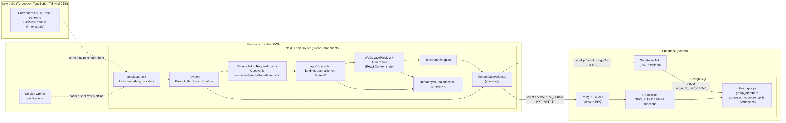
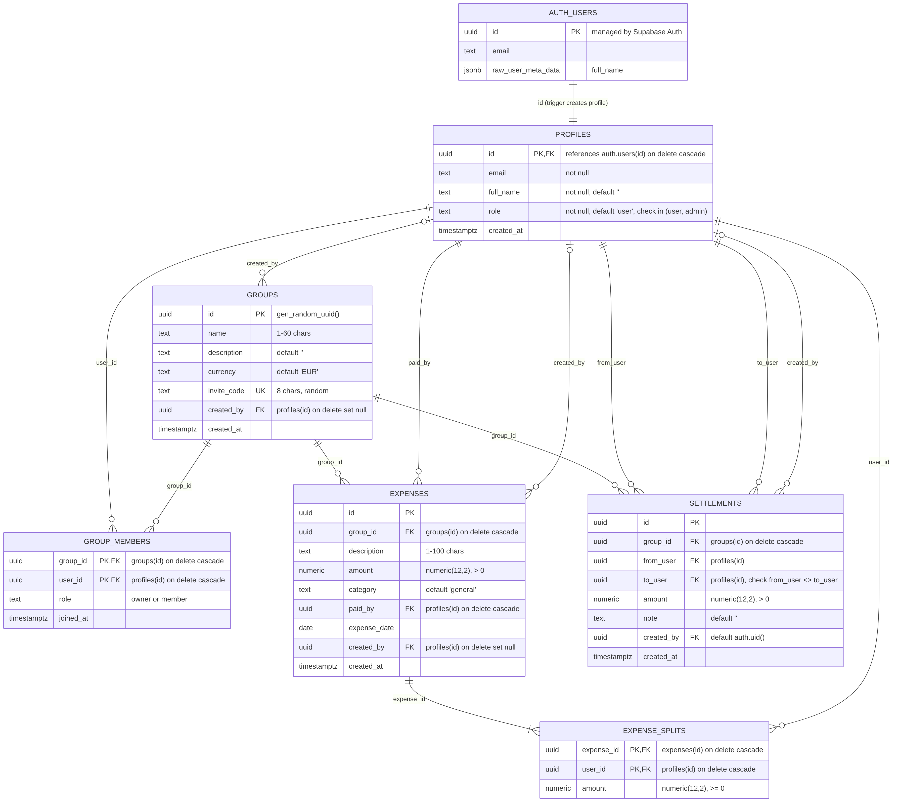

# Payo – Technical Documentation

**Development of a PWA Application for Managing and Splitting Shared Expenses**

This document describes the application exactly as it is implemented in this repository
(versions from `package-lock.json`). Items that can only be confirmed in the hosted Supabase
project are marked **(verify in Supabase)**. The read-only script `supabase/verify_schema.sql`
checks them.

---

## 1. Technology stack

| Technology | Version | Role in Payo |
|---|---|---|
| **Next.js** (App Router) | 16.4.3 | Application framework: file-based routing (`src/app/**/page.tsx`), nested layouts, production build with Turbopack, prerendering of every page's HTML shell, Metadata API (`metadata`, `viewport`), web app manifest (`app/manifest.ts`), self-hosted fonts (`next/font/local`), security headers (`next.config.ts`). |
| **React** | 19.3.0 | UI library. All interactive screens are React function components with hooks, marked as Client Components (`"use client"`). |
| **TypeScript** | 5.9.3 | The only programming language in `src/` (`strict: true`). Database rows are typed in `src/lib/types.ts`. There are no `.js`/`.jsx` source files. |
| **Tailwind CSS** | 4.3.3 | Styling. Components use Tailwind utility classes; the design tokens (colours, fonts) are defined once with `@theme` in `src/app/globals.css`. Shared class sets (buttons, inputs, panels) live in `src/components/ui/classes.ts`. |
| **Supabase** (`@supabase/supabase-js`) | 2.118.0 | Backend as a service: Supabase Auth (email + password, sessions, password reset) and a hosted PostgreSQL database protected by Row Level Security. |
| **Lucide React** | 1.65.0 | SVG icon components. |
| **Motion** (`motion/react`) | 14.9.0 | Animations (landing page, modals, toasts, sidebar indicator, banners). |
| Vitest | 5.0.5 | Unit tests for money, splitting, balance and summary logic (`npm test`). |
| Playwright | 1.63.0 | Browser tests with a mocked Supabase backend (`npm run e2e`). |
| ESLint + `eslint-config-next` | 9.39 / 16.4.3 | Linting (`npm run lint`), including React hooks rules. |

**How Next.js is used (and not used).** Payo is a *client-rendered* application: every page
loads the signed-in user's data in the browser through the Supabase client, and the database
decides what each user may see (RLS). Next.js provides routing, layouts, the build, the
prerendered HTML shell of each route, metadata, the manifest and font handling. Server-side data
fetching, Server Actions, Route Handlers and middleware are **not** used, because Payo has no
server-side code of its own: there is nothing on the server that could be trusted more than the
database's own RLS policies. The template options `cacheComponents` / `partialPrefetching` are
therefore turned off in `next.config.ts`.

---

## 2. System architecture



Mermaid source: `docs/diagrams/architecture.mmd`.

### 2.1 Project structure

```
src/
  app/                              Next.js App Router (one folder = one URL)
    layout.tsx                      <html>, fonts, metadata, viewport, <Providers>
    providers.tsx                   PwaProvider > AuthProvider > ToastProvider > ConfirmProvider
    globals.css                     Tailwind import, @theme tokens, base styles, keyframes
    manifest.ts                     web app manifest (/manifest.webmanifest)
    page.tsx                        /  (landing page)
    login/ register/ forgot-password/ reset-password/   auth pages
    privacy/ terms/ offline/ not-found.tsx              static pages
    signup/page.tsx                 redirect /signup -> /register
    client/layout.tsx               RequireAuth + ClientShell (WorkspaceProvider, sidebar, modals)
    client/page.tsx                 /client (overview)
    client/expenses|groups|summary|activity|settings/page.tsx
    client/groups/[groupId]/page.tsx  group detail (dynamic route)
    admin/layout.tsx                RequireAdmin + AdminShell (admin data context)
    admin/page.tsx, admin/users|groups|expenses/page.tsx
  components/
    providers/                      AuthProvider, PwaProvider, ToastProvider, ConfirmProvider
    auth/                           RouteGuards, AuthLayout, StaticPage, authStyles
    dashboard/                      Workspace, ClientShell, AdminShell, DashboardParts,
                                    AddExpenseModal, GroupModal, useExpenseActions
    admin/AdminPages.tsx            AdminOverview, AdminUsers, AdminGroups, AdminExpenses
    landing/                        HomePage, Header, Footer, CtaBanner, Logo
    layout/DashboardSidebar.tsx     sidebar, mobile top bar and bottom navigation
    pwa/PwaUI.tsx                   offline/update banners, install button and card
    ui/                             Modal, NavLink, classes.ts (shared Tailwind class sets)
  lib/
    types.ts                        TypeScript types for every table
    money.ts, balances.ts, summary.ts, format.ts   calculation and formatting logic
    *.test.ts                       Vitest unit tests
    supabase/client.ts              Supabase client (NEXT_PUBLIC_* env variables)
    supabase/api.ts                 every database query and mutation used by the app
public/
  sw.js                             service worker (plain JavaScript)
  *.png, favicon.ico, robots.txt    icons
supabase/
  schema.sql                        tables, constraints, triggers, RLS policies, RPC functions
  verify_schema.sql                 read-only checks for a live database
e2e/                                Playwright browser tests + mocked Supabase backend
```

### 2.2 Routes

| URL | File | Access |
|---|---|---|
| `/` | `app/page.tsx` | public |
| `/privacy`, `/terms`, `/offline` | `app/<name>/page.tsx` | public (Server Components, static) |
| `/login`, `/register`, `/forgot-password` | `app/<name>/page.tsx` | `GuestOnly`: signed-in users are sent to `/client` (or `?from=`) |
| `/reset-password` | `app/reset-password/page.tsx` | opened from the reset e-mail |
| `/signup` | `app/signup/page.tsx` | redirects to `/register` |
| `/client`, `/client/expenses`, `/client/groups`, `/client/groups/[groupId]`, `/client/summary`, `/client/activity`, `/client/settings` | `app/client/**` | `RequireAuth` in `app/client/layout.tsx` |
| `/admin`, `/admin/users`, `/admin/groups`, `/admin/expenses` | `app/admin/**` | `RequireAdmin` in `app/admin/layout.tsx` |
| anything else | `app/not-found.tsx` | 404 page |

### 2.3 State management

React Context + hooks; no external state library.

| Provider / hook | File | Holds |
|---|---|---|
| `PwaProvider` / `usePwa()` | `components/providers/PwaProvider.tsx` | install prompt, `online`, `isInstalled`, update-ready state; registers `/sw.js` in production |
| `AuthProvider` / `useAuth()` | `components/providers/AuthProvider.tsx` | `session`, `user`, `profile`, `isAdmin`, `loading`, `signIn`, `signUp`, `signOut`, `sendPasswordReset` |
| `ToastProvider` / `useToast()` | `components/providers/ToastProvider.tsx` | notifications |
| `ConfirmProvider` / `useConfirm()` | `components/providers/ConfirmProvider.tsx` | promise-based confirmation dialog |
| `WorkspaceProvider` / `useWorkspace()` | `components/dashboard/Workspace.tsx` | the user's `groups`, `members`, `expenses`, `settlements`, derived `summary`, `refresh()`, modal state |
| `AdminShell` / `useAdminData()` | `components/dashboard/AdminShell.tsx` | all profiles, groups, members, expenses, settlements + lookups (`nameOf`, `groupById`) |

`WorkspaceProvider` loads everything once with `fetchWorkspace(userId)` when the client area opens;
after every successful change the component calls `refresh()`. Balances are **computed in the
browser** from the raw rows (they are not stored in the database).

### 2.4 Supabase client (`src/lib/supabase/client.ts`)

```ts
const supabaseUrl = process.env.NEXT_PUBLIC_SUPABASE_URL;
const supabaseAnonKey = process.env.NEXT_PUBLIC_SUPABASE_ANON_KEY;

export const supabase: SupabaseClient | null =
  isSupabaseConfigured && typeof window !== "undefined"
    ? createClient(supabaseUrl as string, supabaseAnonKey as string, {
        auth: { persistSession: true, autoRefreshToken: true, detectSessionInUrl: true },
      })
    : null;
```

- Only the public **anon** key is used; it does not bypass RLS. No `service_role` key exists in the
  project (verified by searching the source and the built bundle).
- `NEXT_PUBLIC_*` variables are inlined into the browser bundle at build time.
- The session is stored by supabase-js in the browser's `localStorage`.

### 2.5 Styling with Tailwind CSS

Design tokens in `src/app/globals.css`:

```css
@theme {
  --color-payo-green: #20b86b;       /* primary */
  --color-payo-green-dark: #159456;
  --color-payo-green-soft: #eaf8f0;
  --color-payo-bg: #f8f9f7;          /* background */
  --color-payo-ink: #111827;         /* dark text */
  --color-payo-muted: #667085;       /* muted text */
  --font-sans: var(--font-manrope), …;
  --font-display: var(--font-space-grotesk), sans-serif;
}
```

This generates classes such as `bg-payo-green`, `text-payo-muted`, `font-display`. Example
(`src/components/ui/classes.ts`):

```ts
export const form = {
  input:
    "h-11 w-full rounded-[10px] border border-payo-border bg-white px-[13px] text-sm font-medium " +
    "text-payo-ink outline-none focus:border-payo-green focus:shadow-[0_0_0_3px_rgba(32,184,107,0.14)]",
};
```

Responsive behaviour uses the same breakpoints as the original design, e.g.
`max-[760px]:hidden` (phone) and `max-[900px]:w-[220px]` (tablet). Fonts (Manrope, Space Grotesk,
Plus Jakarta Sans, DM Mono) are self-hosted from `src/app/fonts` with `next/font/local`, so they
also load offline.

---

## 3. Database

The database is unchanged by the migration (`supabase/schema.sql`).

### 3.1 Entity Relationship Diagram



Mermaid source: `docs/diagrams/erd.mmd`.

### 3.2 Tables

| Table | Responsibility | Primary key | Main constraints |
|---|---|---|---|
| `profiles` | Public profile of each account and its **role** (`user`/`admin`) | `id` (= `auth.users.id`) | FK → `auth.users` on delete cascade; `role in ('user','admin')` |
| `groups` | A shared-expense group | `id` | name 1–60 chars; `invite_code` unique |
| `group_members` | Membership, with group role `owner`/`member` | (`group_id`, `user_id`) | FKs on delete cascade |
| `expenses` | One expense: amount, payer, category, date | `id` | `amount numeric(12,2) > 0` |
| `expense_splits` | One row per participant with their share | (`expense_id`, `user_id`) | `amount >= 0`; deleted with the expense |
| `settlements` | A **recorded** repayment made outside the app | `id` | `amount > 0`; `from_user <> to_user` |

There is **no `user_roles` table**; the role is `profiles.role` (verify in Supabase: query 2 of
`verify_schema.sql` returns 0 rows). The matching TypeScript types are in `src/lib/types.ts`.

### 3.3 Relationships

1. **Profiles ↔ users.** The trigger `on_auth_user_created` runs `handle_new_user()` and inserts a
   `profiles` row with the same `id`, the e-mail and `full_name` from the sign-up metadata. The role
   always starts as `'user'`.
2. **Roles.** `profiles.role = 'admin'` marks an administrator; `is_admin()` checks it inside RLS.
3. **Groups** are created only through the RPC `create_group`, which also adds the caller as `owner`.
4. **Members** join with `join_group` (invite code) or `add_member_by_email`; leave with
   `leave_group` (ownership passes on, or the group is deleted when the last member leaves).
5. **Expenses** are created only through `create_expense`, which inserts the expense and all
   splits atomically after checking membership and that the splits add up to the total.
6. **Retrieval.** `fetchWorkspace` loads memberships, then groups, members (with
   `profile:profiles(...)`), expenses (with `splits:expense_splits(...)`) and settlements in
   parallel; RLS returns only rows of the user's own groups.

---

## 4. Authentication and authorization

### 4.1 Authentication (Supabase Auth)

| Action | Page | Function | Supabase call |
|---|---|---|---|
| Register | `app/register/page.tsx` | `signUp()` (AuthProvider) | `auth.signUp` with `data: { full_name }` only |
| Log in | `app/login/page.tsx` | `signIn()` | `auth.signInWithPassword` |
| Log out | sidebar, `app/client/settings/page.tsx` | `signOut()` | `auth.signOut` |
| Forgot password | `app/forgot-password/page.tsx` | `sendPasswordReset()` | `auth.resetPasswordForEmail` → `/reset-password` |
| New password | `app/reset-password/page.tsx`, settings | `updatePassword()` | `auth.updateUser({ password })` |

### 4.2 Authorization – two layers

**Layer 1 – route guards (`components/auth/RouteGuards.tsx`).** `RequireAuth` redirects visitors
without a session to `/login?from=<path>`; `RequireAdmin` redirects non-admins to `/client`;
`GuestOnly` sends signed-in users away from login/register. These only decide what is rendered.

**Layer 2 – the database (the security boundary).** RLS is enabled on all six tables:

| Table | SELECT | INSERT | UPDATE | DELETE |
|---|---|---|---|---|
| `profiles` | self, people sharing a group, admin | trigger only | self or admin; only `full_name`, `role` columns | – |
| `groups` | members, admin | `create_group` RPC | owner or admin; `name`, `description`, `currency` | owner or admin |
| `group_members` | members of that group, admin | RPCs | – | self (non-owner), owner, admin |
| `expenses` | members, admin | `create_expense` RPC | – | creator, payer, owner, admin |
| `expense_splits` | members, admin | `create_expense` RPC | – | cascade |
| `settlements` | members, admin | creator = caller and all three are members | – | creator, owner, admin |

The trigger `protect_profile_role` blocks non-admins from changing any role and blocks anyone
from changing their own role. Because sign-up only sends `full_name`, public registration cannot
create an administrator.

### 4.3 Known limitations (documented, unchanged)

- `add_member_by_email` reveals whether an e-mail has an account.
- Invite codes never expire or rotate.
- A member removed with an open balance cannot be settled with (settlements require both people
  to be current members); `verify_schema.sql` query 13 lists such cases.
- Any member can record a payment between two other members (the row stores `created_by`).
- `groups.currency` exists but the UI cannot change it; all groups use EUR.

---

## 5. Expense splitting algorithm (`src/lib/money.ts`)

All money calculations use **integer cents**:

```ts
export const toCents = (value: number | string | null | undefined): Cents =>
  Math.round(Number(value || 0) * 100);

export function splitEqually(totalCents: Cents, ids: string[]): Record<string, Cents> {
  if (!ids.length) return {};
  const base = Math.floor(totalCents / ids.length);
  let remainder = totalCents - base * ids.length;
  const result: Record<string, Cents> = {};
  ids.forEach((id) => {
    result[id] = base + (remainder > 0 ? 1 : 0);
    if (remainder > 0) remainder -= 1;
  });
  return result;
}
```

`base = ⌊total/n⌋`; the first `total − base·n` participants get one extra cent. €100.00 between
3 → 10 000 cents → **€33.34, €33.33, €33.33**. `AddExpenseModal` passes participants in group
join order, so the result is deterministic; the form preview shows "€33.33–€33.34 each" for
uneven splits. Exact (custom) shares must add up to the total in cents before saving.
`create_expense` re-checks on the server that the splits sum to the total; amounts are stored as
`numeric(12,2)`.

Verified by `src/lib/money.test.ts` (sum always equals the total for every total 1–2 000 cents and
1–12 people; shares differ by at most 1 cent; deterministic; `toCents(fromCents(c)) === c` for
0–100 000 cents) and by the browser test that checks the exact RPC payload
(`[33.34, 33.33, 33.33]`, sum 10 000 cents).

---

## 6. Balances and settlements (`src/lib/balances.ts`)

```
net[user] = Σ expenses the user paid − Σ the user's splits
          + Σ settlements the user paid − Σ settlements the user received
```

`net > 0`: the group owes the user. Σ net = 0 in every group. `simplifyDebts(net)` greedily matches
the largest debtor with the largest creditor and needs at most (non-zero members − 1) payments
(a heuristic, not a guaranteed minimum). Property test: in 300 random groups, recording every
suggested payment brings every balance to 0.

**Calculated balances vs. real transactions.** Payo does not move money. "Record a payment"
(`SettleModal` in `app/client/groups/[groupId]/page.tsx` → `createSettlement` → `settlements`)
only records that a repayment happened outside the app.

---

## 7. Data flow of the main operations

| Operation | Page / component | Function | Supabase | UI update |
|---|---|---|---|---|
| Register | `app/register/page.tsx` | `signUp` | `auth.signUp` → trigger inserts `profiles` | `/client`, or "check your inbox" |
| Log in | `app/login/page.tsx` | `signIn` | `auth.signInWithPassword` | redirect to `?from=` or `/client` |
| Log out | `DashboardSidebar`, settings | `signOut` | `auth.signOut` | guards redirect to `/login` |
| Load client data | `app/client/layout.tsx` → `WorkspaceProvider` | `fetchWorkspace` | select 5 queries | `buildSummary` → pages |
| Create / join group | `GroupModal` | `createGroup` / `joinGroup` | RPC `create_group` / `join_group` | `refresh()`, navigate to group |
| Add member | group page | `addMemberByEmail` | RPC `add_member_by_email` | `refresh()` |
| Create expense | `AddExpenseModal` | `splitEqually` → `createExpense` | RPC `create_expense` | close, `refresh()` |
| Delete expense | `useExpenseActions`, `AdminExpenses` | `deleteExpense` | delete `expenses` | `refresh()` |
| Balances / settle up | group page | `computeNetBalances`, `simplifyDebts` | none (computed) | balance list, suggestions |
| Record payment | `SettleModal` | `createSettlement` | insert `settlements` | `refresh()` |
| Activity / summary | `app/client/activity`, `summary` | `monthlySummary` etc. | none (already loaded) | feed, charts |
| Admin data | `app/admin/layout.tsx` → `AdminShell` | `adminFetchAll` | select all tables (RLS `is_admin()`) | admin pages |
| Change role | `AdminUsers` | `adminSetRole` | update `profiles.role` (trigger-checked) | `refresh()` |

---

## 8. PWA and offline behaviour

| Item | Implementation |
|---|---|
| Manifest | `src/app/manifest.ts` → `/manifest.webmanifest`: name, `start_url` `/client?source=pwa`, `display: standalone`, theme `#111827`, icons 192/512 (`any` + `maskable`), shortcuts. |
| Service worker | `public/sw.js` (plain JavaScript), registered by `PwaProvider` in production builds only. Served with `Cache-Control: no-store` (`next.config.ts`). |
| Precache at install | the HTML of every static route plus every `/_next/static` file those pages reference. |
| Runtime caching | pages: network first, cached copy offline; `/_next/static/*`: cache first (content-hashed names); same-origin images: stale-while-revalidate. |
| Never cached | Supabase API and auth requests (other origin) and React Server Component payloads. |
| Unknown page offline | `/offline` page (e.g. a group page never opened on this device). |
| Install / update | `beforeinstallprompt` captured by an inline script in `app/layout.tsx`; iOS instructions; "new version" banner → `SKIP_WAITING`. |

**What works offline and what does not (tested, see TESTING_REPORT.md):**

1. **Interface: yes.** After one online visit, every page's layout loads offline and an offline
   banner is shown.
2. **Data: no.** Data is not stored offline. Signed-in pages show the layout with placeholder
   values ("—") because the Supabase requests cannot complete.
3. **Creating/changing expenses offline: no.** Nothing is queued.
4. **Synchronisation after reconnecting: none needed.** Nothing was stored offline; the data loads
   again when the page is reloaded online.
